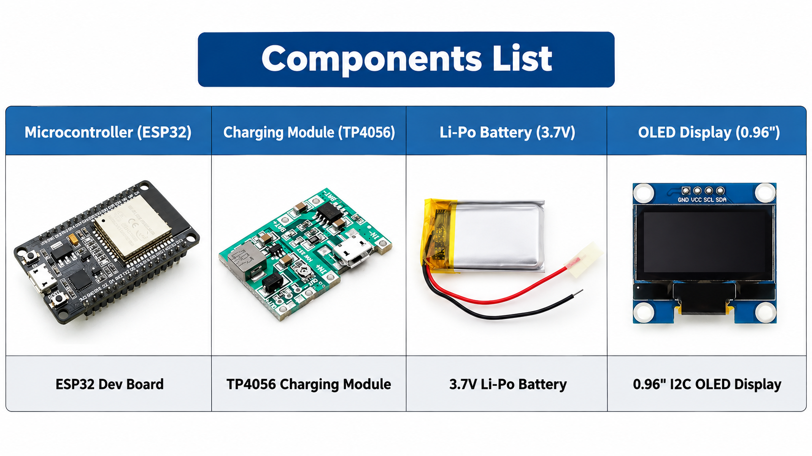

# RS-Deck

**A wireless, 16-action PC control pad built around an ESP32 Dev Module.**

RS-Deck connects to a Windows PC over Bluetooth. Eight buttons provide the main layer, and the Shift button gives access to eight more actions. The Windows application handles profiles, button assignments and connection status.

---
###Components

## 1. Wiring

Keep the wiring exactly as shown below.

### OLED display

| OLED pin | ESP32 Dev Module |
|---|---|
| GND | GND |
| VCC | 3.3V |
| SDA | GPIO 21 |
| SCL | GPIO 22 |

Display: 0.96-inch SSD1306 I2C, 128×64. The usual I2C address is `0x3C`.

### Buttons

Each button connects between its assigned GPIO and GND. All button grounds share the same common GND connection.

| Button | Function | ESP32 GPIO |
|---|---|---:|
| 1 | Action 1 | GPIO 13 |
| 2 | Action 2 | GPIO 14 |
| 3 | Action 3 | GPIO 18 |
| 4 | Action 4 | GPIO 19 |
| 5 | Action 5 | GPIO 23 |
| 6 | Action 6 | GPIO 25 |
| 7 | Action 7 | GPIO 26 |
| 8 | Action 8 | GPIO 27 |
| 9 | Shift / profile control | GPIO 32 |

The firmware uses the ESP32's internal pull-ups: **pressed = LOW; released = HIGH**. No external pull-up resistors are needed.

For a four-leg tactile switch, use one leg from each of its two internally connected sides. Do not connect both wires to legs that are already connected together.

### Battery and power module

| Power connection | Connect to |
|---|---|
| Battery positive | Module B+ |
| Battery negative | Module B- |
| Module regulated 5V output positive | ESP32 VIN / 5V, through the slide switch |
| Module output negative | ESP32 GND |

**Power switch:** Add a small ON/OFF slide switch in series with the positive 5V output wire, between the charging/boost module's `V+` output and the ESP32 `VIN / 5V` pin. This lets the switch disconnect power to the ESP32. Do not put the switch in the GND wire.

> **Important:** Check the labels on your charging/boost module and measure its output with a multimeter before connecting it to the ESP32. Only connect it to VIN/5V after confirming that the output is a regulated 5V. Never connect the battery directly to the 5V pin.

---

## 2. What you need

Install or prepare these before starting:

- Windows 10 or Windows 11 PC.
- ESP32 Dev Module with the RS-Deck firmware binary (`.bin`).
- Arduino IDE 2.x — required only if you need to prepare or verify the ESP32 board environment.
- Espressif Flash Download Tool, or another compatible ESP32 flashing utility.
- Python 3.11 or newer.
- Bluetooth support on the PC (built-in or a compatible adapter).
- The RS-Deck Windows application files.
- A USB data cable for the initial firmware flash.
- A multimeter for checking the power module output.

Downloads:
- [Arduino IDE](https://www.arduino.cc/en/software)
- [Python](https://www.python.org/downloads/windows/)
- [Espressif Flash Download Tool](https://www.espressif.com/en/support/download/other-tools)

The PC application may install its Python packages on first launch. Internet access is needed for that initial setup.

---

## 3. Prepare the ESP32

1. Check that the board is the existing **ESP32 Dev Module** and that the chip supports Bluetooth Classic.
2. Download and open the Espressif Flash Download Tool.
3. Connect the ESP32 to the PC with a USB data cable.
4. Select the correct ESP32 target and the COM port belonging to the USB-connected board.
5. Add the supplied RS-Deck firmware binary.
6. Enter the flash address specified for that binary and its build. Do not guess an address or use an address from an unrelated firmware package.
7. Select the correct flash settings for the board, then start the flash operation.
8. Wait for the tool to report that flashing has completed successfully.
9. Disconnect USB when finished. Normal use is wireless.

**A note about flash images:** A standalone application binary and a complete flash image are not the same thing. A standalone application binary requires the matching bootloader and partition table to already be present on the ESP32. If the board is blank or has been fully erased, use the complete image and its matching flash layout instead. Do not erase the flash unless you have all required image files and their correct addresses.

---

## 4. Pair RS-Deck with Windows

1. Power on RS-Deck.
2. On Windows, open **Settings → Bluetooth & devices**.
3. Turn Bluetooth on and choose **Add device → Bluetooth**.
4. Select **RS-Deck** when it appears.
5. Complete pairing.

Pairing is not the same as an active connection. The Windows application must open the Bluetooth serial connection before the device is considered connected.

### Find the Bluetooth COM port

1. Press `Win + R`.
2. Enter `control printers` and press Enter.
3. Find **RS-Deck**, open its Bluetooth properties, and look for the **Services** or **COM Ports** section (the exact layout varies by Windows version).
4. Note the **Outgoing** Bluetooth Serial Port (SPP) COM number.
5. Do not select an Incoming port for the PC application.

Windows normally keeps the same outgoing COM port for a paired device. If you remove and pair the device again, Windows may assign a different one.

---

## 5. Set up the Windows application

1. Install Python 3.11 or newer. During installation, enable **Add Python to PATH**.
2. Extract the RS-Deck application folder to a location you will keep, such as Documents.
3. Open the application folder.
4. Double-click `run_rs_deck.bat`.
5. Allow the first launch to finish installing the required packages.
6. In RS-Deck, select the outgoing Bluetooth COM port found in the previous section.
7. Connect. Wait until the application reports an active connection.
8. The application should remember the selected port and attempt to reconnect when RS-Deck becomes available again.

Keep the application folder in the same location after setup. If the COM port changes, select the new outgoing port in the application.

---

## 6. Configure buttons and profiles

RS-Deck has two button layers:

- **Normal layer:** Buttons 1–8 provide eight actions.
- **Shift layer:** Press the physical Shift button once to access the other eight actions.

That gives you **16 programmable actions** in total. The Shift button is a layer/profile control; it is not one of the ordinary action buttons.

### Profiles

The application supports profiles such as:

- Default
- Premiere Pro
- Photoshop
- OBS

You can assign different actions to each profile. Use the application's profile controls to select or configure the profile and set the actions you want for each button.

A quick triple-press of the physical Shift button cycles to the next profile. A single press toggles the Shift layer.

---

## 7. First connection check

Use this order for the first test:

1. Power on RS-Deck and wait for its startup screen.
2. Check that the OLED turns on.
3. Start the Windows application.
4. Confirm that the application reports an active Bluetooth connection.
5. Press Button 1 and check that its assigned action runs.
6. Press Shift once, then press another button to test the shifted action.
7. Triple-press Shift to move to the next profile.
8. If automatic profile switching is enabled, open a supported application and check that the profile changes as configured.

If the OLED does not turn on, check its wiring and power first. If Windows can pair with RS-Deck but the application cannot connect, check that you selected the outgoing SPP COM port.

---

## 8. Things to avoid

- **Do not change the GPIO assignments** in the wiring table.
- Do not connect a button between GPIO and 3.3V. Each button goes between its GPIO and GND.
- Do not connect the OLED VCC to 5V; this wiring uses 3.3V.
- Do not connect an unverified boost-module output to VIN/5V.
- Do not reverse battery polarity or short the battery terminals.
- Do not choose the Incoming Bluetooth COM port in the application.
- Do not assume that “Paired” means the application is connected.
- Do not open the same Bluetooth COM port in multiple applications at once.
- Do not erase ESP32 flash or guess a firmware flash address.
- Do not unplug the ESP32 while firmware flashing is in progress.
- Do not move or rename the application folder after configuring its launcher unless you are ready to set it up again.

---

## 9. Troubleshooting

| Problem | Check |
|---|---|
| RS-Deck does not appear in Bluetooth devices | Power-cycle the device, make sure it is not already connected to another PC, and scan again. |
| Paired, but application says disconnected | Confirm the outgoing SPP COM port and make sure no other program is using it. |
| Application cannot open the COM port | Close serial monitors and other apps, then restart the RS-Deck application. |
| COM port changed | Find the new outgoing port in Windows and select it in the application. |
| OLED is blank | Check GND, 3.3V, SDA GPIO 21 and SCL GPIO 22. |
| A button does not respond | Check that it connects its GPIO to common GND and that the switch legs are on opposite internal sides. |
| Firmware flash fails | Check the USB data cable, selected COM port, ESP32 target, flash address and whether the image matches the selected flash layout. |

---

## Project notes

- Device name: **RS-Deck**
- Board: **ESP32 Dev Module**
- Wireless link: **Bluetooth Classic Serial Port Profile (SPP)**
- Display: **SSD1306 I2C, 128×64**
- Controls: **8 action buttons + 1 Shift button**
- Action capacity: **16 assignments per profile**

The Windows application is responsible for the live connection indicator. A Bluetooth pairing entry in Windows alone is not proof that the application has an active serial session.

---

## Connect with me

- **YouTube:** [@rejoan-siyam](https://www.youtube.com/@rejoan-siyam)
- **Instagram:** [@rst.siu](https://www.instagram.com/rst.siu/)
